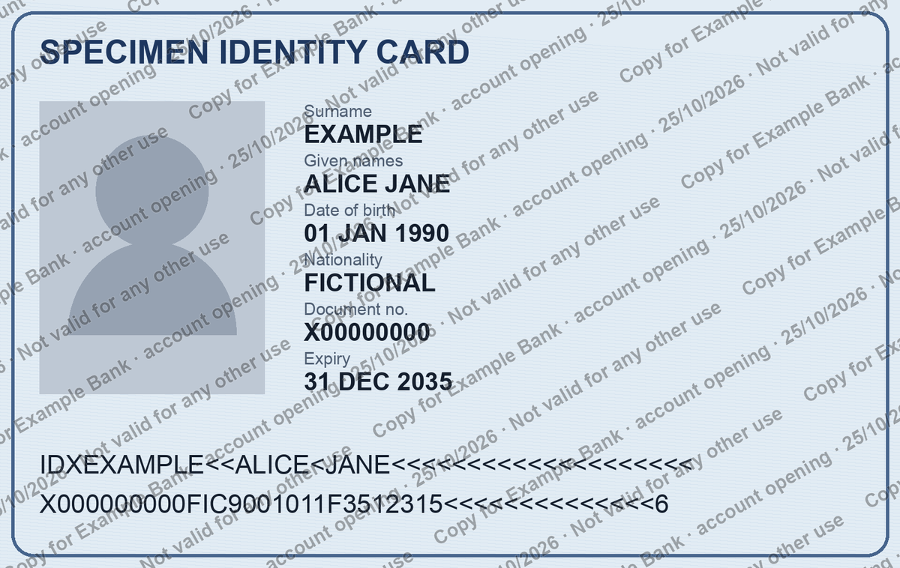

# watermark-id

A skill that watermarks your passport, ID card, bank details or proof of address before your agent sends a copy anywhere. Each copy says who it was for, why and when, so a leaked copy is far less useful to identity thieves.



The watermark covers the whole document while the photo, fields and machine-readable lines stay legible. Everything runs locally: the document is never uploaded to a watermarking service.

## What it does

- Stamps a tiled diagonal watermark: recipient, purpose, date and "not valid for any other use", in French or English.
- Accepts JPEG, PNG, HEIC, WebP and PDF.
- Flattens PDFs into images, so the watermark cannot be deleted as a separate layer.
- Strips EXIF metadata, including the GPS location phone photos carry.
- Warns before watermarking a document bound for an automated identity check (selfie plus document capture), where a watermark can cause a rejection.

## Requirements

- [uv](https://docs.astral.sh/uv/) (the script declares its own Python dependencies)
- `pdftoppm` from Poppler, for PDFs (`brew install poppler` on macOS)
- ImageMagick, for the agent's visual check of the output (`brew install imagemagick`)

## Installation

```bash
npx skills add HartreeWorks/skill--watermark-id
```

### Make your agent use it every time

The skill's description lets your agent find it, but the moment a document gets sent is usually in the middle of some other task, such as filling in a form or drafting an email. A rule in your global agent instructions (`AGENTS.md`, `CLAUDE.md` or equivalent) makes the habit reliable:

```markdown
- **ID documents:** before any copy of an identity document (passport, ID card, RIB, proof of address, tax notice) is sent, uploaded or attached, watermark it with the `watermark-id` skill.
```

## Try it

Ask your agent:

```text
Watermark ~/Downloads/passport.jpg for Example Bank, for opening a savings account.
```

Your agent writes `passport-watermarked-example-bank.jpg` next to the original, checks it visually and tells you where it is.

You can also run the script directly:

```bash
scripts/watermark.py passport.jpg --recipient "Example Bank" --purpose "account opening" --lang en
```

## Documentation

See [SKILL.md](./SKILL.md) for complete documentation and usage instructions.

## About

Created by [Peter Hartree](https://x.com/peterhartree) of [AI Wow](https://wow.pjh.is).

Find more skills at [HartreeWorks/skills](https://github.com/HartreeWorks/skills).
